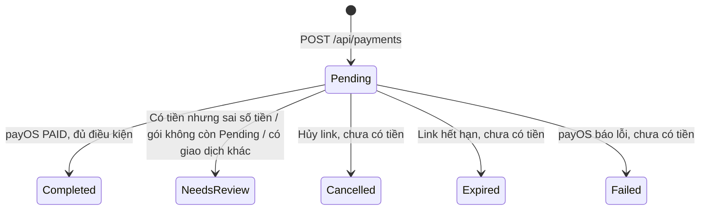

# API Thanh toán (`/api/payments`)

Tài liệu cho `Controllers/PaymentController.cs` và `Services/Implement/PaymentService.cs`.

Thanh toán online dùng **payOS** (chuyển khoản qua mã QR). Thanh toán tại quầy (tiền mặt, chuyển khoản, thẻ) do lễ tân xác nhận qua `POST /api/member-subscriptions/{id}/payments`, không nằm trong controller này.

## Tổng quan

| Method | Route | Role | Mô tả |
|---|---|---|---|
| GET | `/api/payments` | Member, Receptionist, Manager | Lịch sử thanh toán |
| GET | `/api/payments/{id}` | Member, Receptionist, Manager | Chi tiết một giao dịch |
| POST | `/api/payments` | Member, Receptionist, Manager | Tạo (hoặc lấy lại) link payOS cho một đăng ký gói |
| POST | `/api/payments/{id}/sync` | Member, Receptionist, Manager | Hỏi lại payOS để cập nhật trạng thái |
| POST | `/api/payments/{id}/cancel` | Member, Receptionist, Manager | Hủy link payOS đang chờ |
| POST | `/api/payments/payos/webhook` | Không cần đăng nhập (payOS gọi) | Nhận thông báo kết quả từ payOS |
| GET | `/api/payments/{id}/export-pdf` | Member, Receptionist, Manager | Tải biên lai PDF |

**Phạm vi dữ liệu:**
- Member chỉ thấy và thao tác trên giao dịch của chính mình. Gọi vào giao dịch của người khác trả `403` (riêng `export-pdf` trả `404`).
- Receptionist và Manager thấy mọi giao dịch.
- Coach và Admin không có quyền gọi các API này (`403`).

## Trạng thái giao dịch (`status`)

| Trạng thái | Ý nghĩa |
|---|---|
| `Pending` | Đã tạo link payOS, chờ khách chuyển tiền |
| `Completed` | Đã nhận đủ tiền, gói tập đã được kích hoạt, có mã biên lai `INV-...` |
| `Cancelled` | Link bị hủy, chưa nhận tiền |
| `Expired` | Link hết hạn, chưa nhận tiền |
| `Failed` | payOS báo thất bại, chưa nhận tiền |
| `NeedsReview` | Có tiền về nhưng không kích hoạt gói tự động được, cần nhân viên đối soát |



`Completed` là trạng thái cuối: webhook hay `sync` gọi lại đều không đổi nó nữa.

## Định dạng phản hồi

Thành công (bọc trong `ApiResponse`):

```json
{
  "success": true,
  "statusCode": 200,
  "message": "Lấy thông tin thanh toán thành công.",
  "data": { },
  "errors": null,
  "timestamp": "2026-11-25T03:00:00Z"
}
```

Lỗi nghiệp vụ (do `ExceptionMiddleware` trả về):

```json
{
  "statusCode": 409,
  "message": "Chỉ thanh toán đăng ký gói đang Pending."
}
```

Lỗi sai kiểu dữ liệu đầu vào (ví dụ thiếu `reason`) do ASP.NET Core tự kiểm tra, trả `400` dạng `ProblemDetails` có trường `errors`.

### Đối tượng `PaymentDTO`

| Trường | Kiểu | Ghi chú |
|---|---|---|
| `id` | int | Mã giao dịch |
| `memberId` | int | Hội viên |
| `subscriptionId` | int? | Đăng ký gói được thanh toán |
| `amount` | decimal | Số tiền cần thu, lấy từ `AgreedPrice` đã chốt lúc đăng ký gói |
| `amountReceived` | decimal | Số tiền payOS báo đã nhận |
| `paymentMethod` | string | `PayOS`, `Cash`, `BankTransfer`, `CreditCard` |
| `status` | string | Xem bảng trạng thái |
| `createdAt` | DateTime (UTC) | Lúc tạo giao dịch |
| `paidAt` | DateTime? (UTC) | Chỉ có khi `Completed` |
| `transactionReference` | string? | Mã biên lai `INV-yyyyMMdd-xxxxxxxx`, chỉ có khi `Completed` |
| `payOSOrderCode` | long? | Mã đơn gửi sang payOS, sinh từ sequence PostgreSQL, không trùng |
| `payOSPaymentLinkId` | string? | Mã link payOS |
| `gatewayStatus` | string? | Trạng thái gốc payOS trả về (`PENDING`, `PAID`, `CANCELLED`...) |
| `checkoutUrl` | string? | Trang thanh toán payOS để mở cho khách |
| `qrCode` | string? | Chuỗi VietQR để frontend vẽ mã QR |
| `expiresAt` | DateTime? | Hiện chưa được gán, luôn là `null` |
| `reviewReason` | string? | Lý do khi `NeedsReview` |

---

## GET `/api/payments`

Lấy lịch sử thanh toán, mới nhất trước. Member chỉ nhận giao dịch của mình.

**Request**

```http
GET /api/payments
Authorization: Bearer <accessToken>
```

**Response `200`**

```json
{
  "success": true,
  "statusCode": 200,
  "message": "Lấy danh sách thanh toán thành công.",
  "data": [
    {
      "id": 12,
      "memberId": 3,
      "subscriptionId": 8,
      "amount": 500000,
      "amountReceived": 500000,
      "paymentMethod": "PayOS",
      "status": "Completed",
      "createdAt": "2026-11-20T02:10:00Z",
      "paidAt": "2026-11-20T02:12:31Z",
      "transactionReference": "INV-20261120-00000012",
      "payOSOrderCode": 1000012,
      "payOSPaymentLinkId": "a1b2c3...",
      "gatewayStatus": "PAID",
      "checkoutUrl": "https://pay.payos.vn/web/a1b2c3...",
      "qrCode": "000201010212...",
      "expiresAt": null,
      "reviewReason": null
    }
  ],
  "errors": null,
  "timestamp": "2026-11-25T03:00:00Z"
}
```

**Lỗi**

| Mã | Khi nào |
|---|---|
| 401 | Chưa đăng nhập, hoặc tài khoản đã bị khóa |
| 403 | Role không phải Member, Receptionist, Manager |

---

## GET `/api/payments/{id}`

**Request**

```http
GET /api/payments/12
Authorization: Bearer <accessToken>
```

**Response `200`**: `data` là một `PaymentDTO`, message `"Lấy thông tin thanh toán thành công."`.

**Lỗi**

| Mã | Message |
|---|---|
| 403 | `Không có quyền truy cập thanh toán này.` (Member xem giao dịch của người khác) |
| 404 | `Không tìm thấy thanh toán.` |

---

## POST `/api/payments`

Tạo link payOS cho một đăng ký gói đang `Pending`.

**Bấm nhiều lần không tạo trùng:** nếu đăng ký gói đã có một giao dịch payOS `Pending`, API trả lại đúng giao dịch đó (cùng `payOSOrderCode`, cùng `checkoutUrl`). Vì vậy khách mở hai tab hoặc request bị gửi lại do timeout vẫn chỉ có một giao dịch.

**Request**

```http
POST /api/payments
Authorization: Bearer <accessToken>
Content-Type: application/json

{
  "subscriptionId": 8
}
```

| Trường | Bắt buộc | Ràng buộc |
|---|---|---|
| `subscriptionId` | Có | Số nguyên ≥ 1 |

**Response `200`**

```json
{
  "success": true,
  "statusCode": 200,
  "message": "Lấy thông tin thanh toán payOS thành công.",
  "data": {
    "id": 13,
    "memberId": 3,
    "subscriptionId": 8,
    "amount": 500000,
    "amountReceived": 0,
    "paymentMethod": "PayOS",
    "status": "Pending",
    "createdAt": "2026-11-25T03:00:00Z",
    "paidAt": null,
    "transactionReference": null,
    "payOSOrderCode": 1000013,
    "payOSPaymentLinkId": "d4e5f6...",
    "gatewayStatus": "PENDING",
    "checkoutUrl": "https://pay.payos.vn/web/d4e5f6...",
    "qrCode": "000201010212...",
    "expiresAt": null,
    "reviewReason": null
  },
  "errors": null,
  "timestamp": "2026-11-25T03:00:00Z"
}
```

Nếu gọi payOS tạo link bị lỗi, server hỏi lại payOS theo cùng mã đơn và trả message `"Đã đối chiếu lại yêu cầu thanh toán."`.

**Các bước xử lý**
1. Kiểm tra đăng ký gói, quyền và điều kiện trong một transaction `Serializable`.
2. Có giao dịch `Pending` thì dùng lại, chưa có thì tạo mới với `payOSOrderCode` lấy từ sequence `PayOSOrderNumbers`.
3. Lưu giao dịch vào database **trước**, sau đó mới gọi payOS tạo link. Nếu server lỗi giữa chừng thì vẫn còn bản ghi để đối soát.
4. Hỏi lại payOS để lấy `checkoutUrl`, `qrCode`, `gatewayStatus` mới nhất.

**Lỗi**

| Mã | Message | Khi nào |
|---|---|---|
| 400 | `Vui lòng chọn đăng ký gói.` | `subscriptionId` ≤ 0 |
| 400 | `Giá thanh toán phải là số nguyên VND dương hợp lệ.` | Giá đã chốt ≤ 0, có số lẻ hoặc quá lớn |
| 403 | `Không có quyền truy cập thanh toán này.` | Member thanh toán gói của người khác |
| 404 | `Không tìm thấy đăng ký gói.` | |
| 409 | `Chỉ thanh toán đăng ký gói đang Pending.` | Gói đã Active, Cancelled... |
| 409 | `Tài khoản hội viên đã ngừng hoạt động.` | |
| 409 | `Thời hạn gói không hợp lệ.` | `DurationInDays` ngoài 1–36500 |
| 409 | `Đăng ký đã thanh toán hoặc có giao dịch cần đối soát.` | Đã có giao dịch `Completed` hoặc `NeedsReview` |
| 503 | `Chưa lấy được trạng thái payOS. Thử đồng bộ lại giao dịch này.` | payOS không phản hồi |

---

## POST `/api/payments/{id}/sync`

Hỏi payOS trạng thái thật của giao dịch rồi cập nhật database. Frontend gọi API này khi khách quay về từ trang payOS, hoặc khi khách bấm "Kiểm tra lại".

**Request**

```http
POST /api/payments/13/sync
Authorization: Bearer <accessToken>
```

**Response `200`**
- Đã `Completed` từ trước: trả ngay, message `"Thanh toán đã hoàn tất."`, không gọi payOS.
- Còn lại: message `"Đồng bộ trạng thái thanh toán thành công."`, `data` là trạng thái mới.

**Kết quả theo trạng thái payOS**

| payOS trả về | Tiền đã nhận | Kết quả |
|---|---|---|
| `PAID` | Đủ, và gói còn `Pending`, không có giao dịch khác | `Completed`, kích hoạt gói |
| `PAID` | Thiếu/thừa, hoặc gói không còn `Pending`, hoặc tài khoản bị khóa | `NeedsReview` |
| `CANCELLED` / `EXPIRED` / `FAILED` | 0 | `Cancelled` / `Expired` / `Failed` |
| `CANCELLED` / `EXPIRED` / `FAILED` | > 0 | `NeedsReview` |
| Trạng thái khác (`PENDING`...) | > 0 | `NeedsReview` |
| Trạng thái khác (`PENDING`...) | 0 | Giữ `Pending` |

**Lỗi**

| Mã | Message |
|---|---|
| 400 | `Giao dịch này không sử dụng payOS.` |
| 403 | `Không có quyền truy cập thanh toán này.` |
| 404 | `Không tìm thấy thanh toán.` |
| 502 | `Kết quả payOS không khớp thanh toán.` (mã đơn hoặc mã link payOS trả về khác bản ghi) |
| 503 | `Chưa lấy được trạng thái payOS. Thử đồng bộ lại giao dịch này.` |

---

## POST `/api/payments/{id}/cancel`

Hủy link payOS đang chờ. Chỉ áp dụng cho giao dịch payOS ở trạng thái `Pending`.

**Request**

```http
POST /api/payments/13/cancel
Authorization: Bearer <accessToken>
Content-Type: application/json

{
  "reason": "Khách đổi sang trả tiền mặt"
}
```

| Trường | Bắt buộc | Ràng buộc |
|---|---|---|
| `reason` | Có | 1–200 ký tự |

**Response `200`**: message `"Đã đối chiếu kết quả yêu cầu hủy."`.

`data.status` thường là `Cancelled`. Nếu khách đã kịp chuyển tiền trước khi hủy thì kết quả là `Completed` hoặc `NeedsReview` theo bảng ở phần `sync`, nên frontend phải đọc `status` chứ không mặc định là đã hủy.

Nếu lệnh hủy gửi sang payOS bị lỗi hoặc timeout, server hỏi lại payOS để lấy trạng thái thật.

**Lỗi**

| Mã | Message |
|---|---|
| 400 | `Lý do hủy phải từ 1 đến 200 ký tự.` |
| 403 | `Không có quyền truy cập thanh toán này.` |
| 404 | `Không tìm thấy thanh toán.` |
| 409 | `Chỉ hủy link payOS đang Pending.` |
| 503 | `Chưa lấy được trạng thái payOS. Thử đồng bộ lại giao dịch này.` |

---

## POST `/api/payments/payos/webhook`

payOS gọi API này khi có kết quả giao dịch. Frontend **không** gọi API này. Không cần JWT, nhưng chữ ký `signature` phải đúng với checksum key của payOS.

**Request (payOS gửi)**

```json
{
  "code": "00",
  "desc": "success",
  "success": true,
  "data": {
    "orderCode": 1000013,
    "amount": 500000,
    "description": "SUB-13",
    "accountNumber": "12345678",
    "reference": "FT2633012345",
    "transactionDateTime": "2026-11-25 10:05:12",
    "currency": "VND",
    "paymentLinkId": "d4e5f6...",
    "code": "00",
    "desc": "success"
  },
  "signature": "8d8640d8..."
}
```

**Response `200`**

```json
{ "success": true }
```

**Các bước xử lý**
1. Xác minh chữ ký. Sai chữ ký trả `400`, không đọc dữ liệu.
2. `data.code` khác `"00"` (giao dịch không thành công): bỏ qua, trả `200`.
3. Kiểm tra `currency` là `VND`, `amount` > 0, có `paymentLinkId`.
4. Tìm giao dịch theo `orderCode`. Không có (ví dụ dữ liệu mẫu payOS gửi khi đăng ký webhook): bỏ qua, trả `200`.
5. `paymentLinkId` khác bản ghi: trả `400`.
6. Giao dịch đã `Completed` (payOS gửi lại lần 2, lần 3...): bỏ qua, trả `200`. Gói không bị kích hoạt hai lần.
7. **Không tin số liệu trong webhook**: hỏi lại payOS trạng thái thật, rồi xử lý giống `sync`.

**Lỗi**

| Mã | Message |
|---|---|
| 400 | `Dữ liệu hoặc chữ ký webhook không hợp lệ.` |
| 400 | `Dữ liệu giao dịch webhook không hợp lệ.` (sai loại tiền, số tiền ≤ 0, thiếu mã link) |
| 400 | `Mã link thanh toán không khớp.` |
| 502 | `Kết quả payOS không khớp thanh toán.` |
| 503 | `Chưa lấy được trạng thái payOS. Thử đồng bộ lại giao dịch này.` |

Khi nhận mã lỗi, payOS sẽ gửi lại webhook. Nhờ bước 6, gửi lại nhiều lần vẫn an toàn.

---

## GET `/api/payments/{id}/export-pdf`

Tải biên lai PDF (khổ A5) của giao dịch đã `Completed`.

**Request**

```http
GET /api/payments/12/export-pdf
Authorization: Bearer <accessToken>
```

**Response `200`**: file `application/pdf`, tên `BienLai_12.pdf`.

**Nội dung biên lai**
- Mã biên lai `transactionReference`
- Ngày thanh toán, hiển thị theo giờ Việt Nam (UTC+7)
- Phương thức: Tiền mặt, Chuyển khoản, Thẻ tín dụng, payOS
- Tên hội viên và tên gói **lấy từ bản lưu lúc thanh toán** (`MemberNameSnapshot`, `PackageNameSnapshot`). Hội viên đổi tên hay admin đổi tên gói sau đó thì biên lai cũ vẫn giữ nguyên.
- Tổng tiền đã thanh toán (`AmountReceived`)

**Lỗi**

| Mã | Body | Khi nào |
|---|---|---|
| 400 | `{ "message": "Chỉ xuất biên lai cho giao dịch đã hoàn tất." }` | Giao dịch chưa `Completed` |
| 404 | `{ "message": "Không tìm thấy giao dịch bạn được phép truy cập." }` | Không có, hoặc Member tải biên lai của người khác |

---

## Cơ chế chống trùng và đối soát

| Tình huống | Cách hệ thống xử lý |
|---|---|
| payOS gửi webhook nhiều lần | Giao dịch đã `Completed` thì bỏ qua |
| Khách mở 2 tab, bấm thanh toán 2 lần | Dùng lại giao dịch `Pending` đang có |
| Webhook và `sync` chạy cùng lúc | Transaction `Serializable` và index unique: mỗi đăng ký gói chỉ có 1 giao dịch `Completed` |
| Hai giao dịch cùng báo đã trả tiền | Giao dịch đầu `Completed`, giao dịch sau `NeedsReview` |
| Số tiền nhận khác số tiền cần thu | `NeedsReview`, không kích hoạt gói |
| Khách trả tiền sau khi gói đã bị hủy hoặc đã kích hoạt | `NeedsReview` |
| Lễ tân thu tiền mặt khi còn link payOS đang chờ | Bị chặn `409`, phải `sync` hoặc `cancel` link trước |
| Server lỗi giữa lúc ghi dữ liệu | Transaction rollback, giao dịch vẫn `Pending`; webhook gửi lại hoặc `sync` sẽ xử lý tiếp |

Giao dịch `NeedsReview` chặn mọi thao tác thu tiền hay hủy gói tiếp theo của đăng ký gói đó, cho đến khi được xử lý. **Hiện chưa có API để xử lý `NeedsReview`** (duyệt kích hoạt hoặc đánh dấu hoàn tiền); nhân viên phải xử lý trực tiếp trong database.
