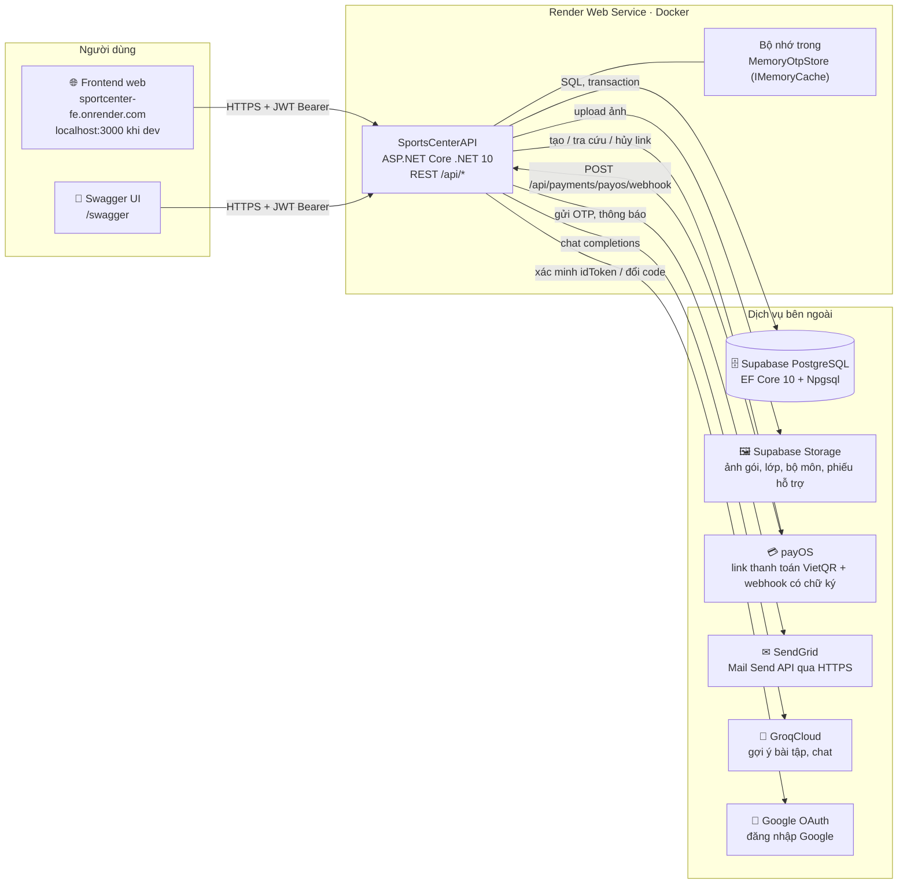
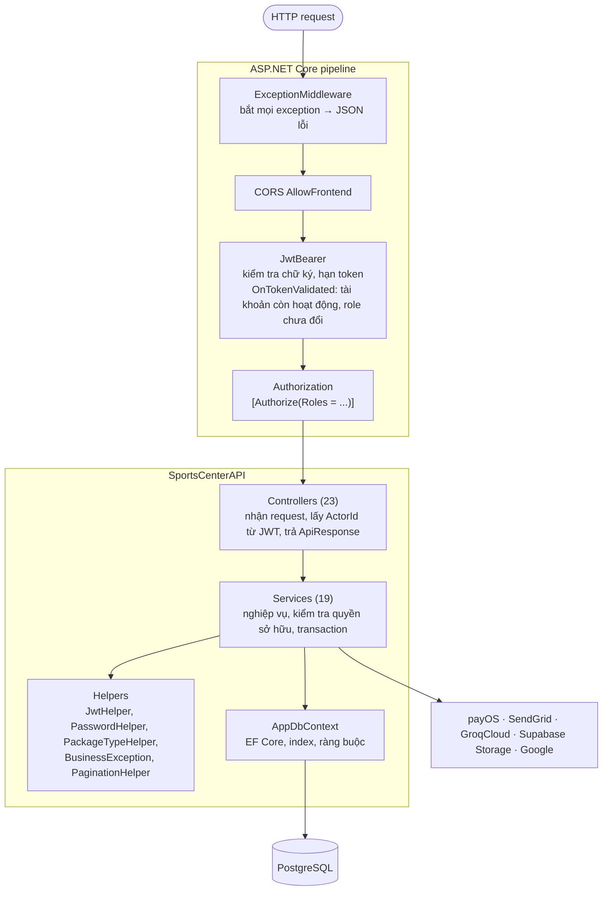
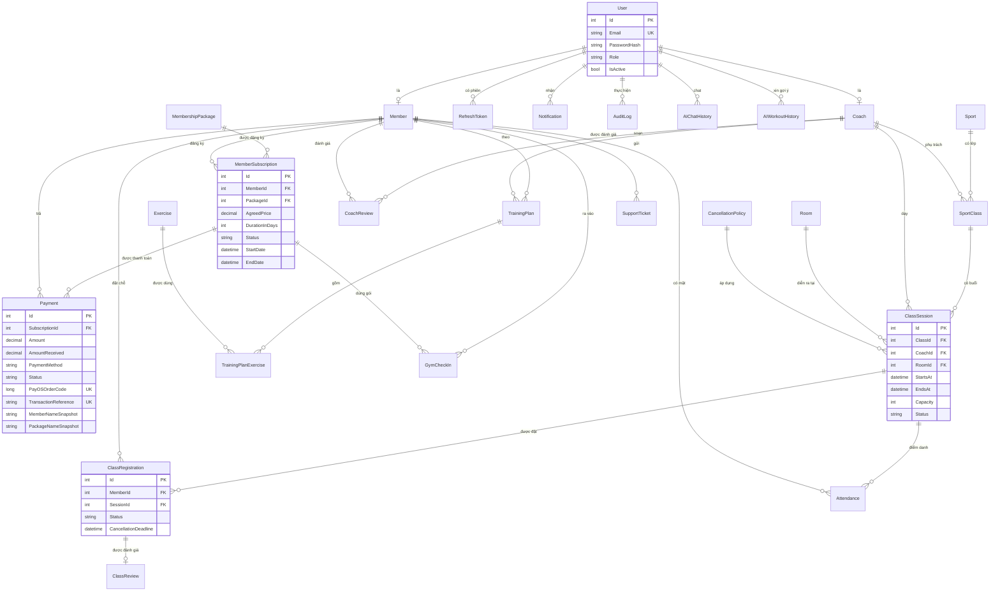
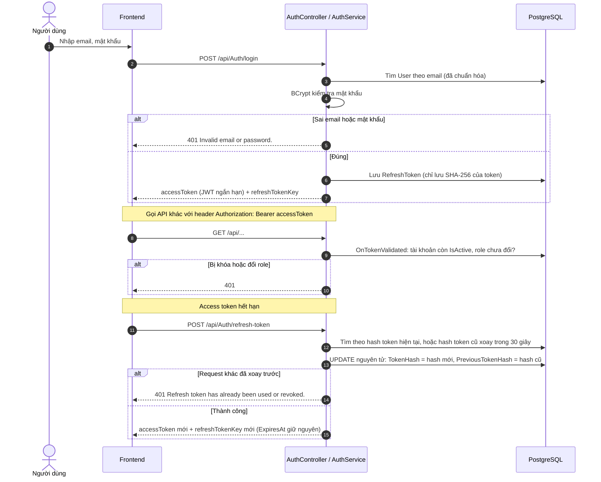
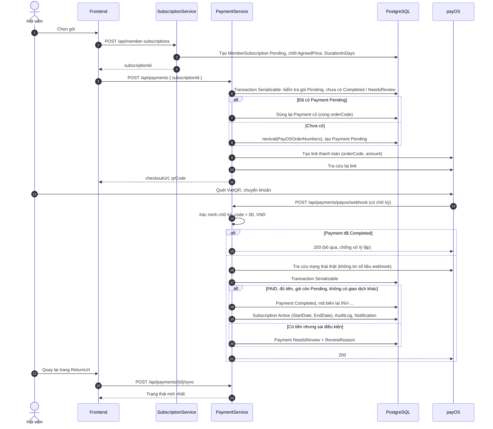
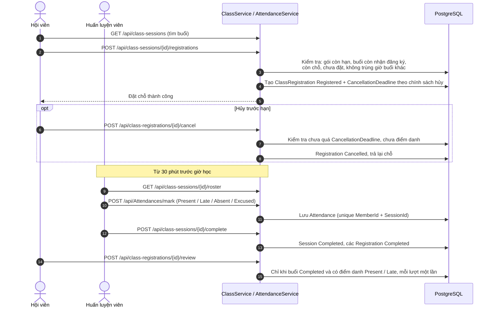
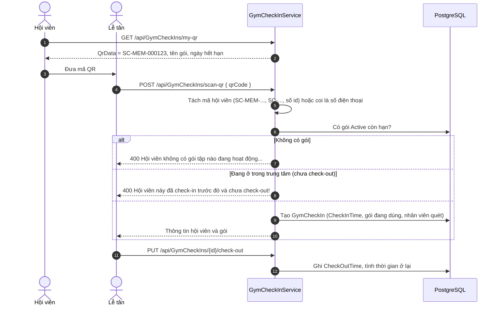

# Kiến trúc hệ thống — Sports Center Management System

Tài liệu mô tả backend `SportsCenterAPI`: các thành phần, cách chúng gọi nhau, dữ liệu lưu ở đâu và các luồng nghiệp vụ chính. Các sơ đồ viết bằng Mermaid, GitHub tự vẽ thành hình.

## 1. Bối cảnh hệ thống

| Thành phần | Vai trò | Cấu hình |
|---|---|---|
| SportsCenterAPI | Toàn bộ nghiệp vụ, một ứng dụng duy nhất (monolith) | `Program.cs` |
| Supabase PostgreSQL | Lưu toàn bộ dữ liệu nghiệp vụ | `ConnectionStrings:DefaultConnection` |
| Supabase Storage | Lưu file ảnh, database chỉ lưu URL | `SupabaseStorage:*` |
| payOS | Thanh toán online bằng VietQR | `PayOS:*` |
| SendGrid | Gửi email OTP | `SendGrid:ApiKey`, `MailSettings:*` |
| GroqCloud | Mô hình AI | `AI:ApiKey`, `AI:Model` |
| Google OAuth | Đăng nhập bằng Google | `GoogleAuth:*` |
| MemoryOtpStore | Lưu OTP đăng ký / quên mật khẩu, hết hạn 5 phút | Không cần cấu hình |

## 2. Kiến trúc phân tầng

**Quy ước giữa các tầng**
- **Controller** không chứa nghiệp vụ. Chỉ lấy `ActorId` (id người đang đăng nhập) từ claim `NameIdentifier` trong JWT, gọi service, rồi bọc kết quả trong `ApiResponse`.
- **Service** tự kiểm tra lại quyền sở hữu dữ liệu: Member chỉ thao tác trên dữ liệu của mình. Thao tác ghi quan trọng (thanh toán, đặt chỗ, đăng ký gói) chạy trong transaction `Serializable`.
- **Lỗi nghiệp vụ** ném `BusinessException(statusCode, message)`; `ExceptionMiddleware` chuyển thành JSON. Xem [exception-matrix.md](exception-matrix.md).
- **Ngoại lệ đã biết:** `PaymentsController.ExportInvoicePdf` và `AuditLogsController` truy cập `AppDbContext` trực tiếp, không qua service.

**Đăng ký service (`Program.cs`)**
- `Scoped`: các service nghiệp vụ, mỗi request một instance, dùng chung `AppDbContext` của request đó.
- `Singleton`: `MemoryOtpStore`, `TimeProvider`.
- `HttpClient`: `EmailService` (timeout 30 giây), `AIService` (60 giây), `SupabaseImageStorage`, `GoogleTokenVerifier`.

## 3. Mô hình dữ liệu

25 entity trong `Models/`. Sơ đồ dưới chỉ vẽ quan hệ chính.

**Ràng buộc chống trùng ở database** (khai báo trong `Data/AppDbContext.cs`):

| Index unique | Chặn tình huống |
|---|---|
| `Users.Email` | Hai tài khoản cùng email |
| `Members.UserId`, `Coaches.UserId` | Một tài khoản có hai hồ sơ hội viên / huấn luyện viên |
| `ClassRegistrations(MemberId, SessionId)` khi chưa hủy | Đặt cùng một buổi hai lần |
| `Attendances(MemberId, SessionId)` | Điểm danh hai lần |
| `ClassReviews.RegistrationId` | Đánh giá một lượt học hai lần |
| `Payments.SubscriptionId` khi `Status = 'Completed'` | Một đăng ký gói được thanh toán hai lần |
| `Payments.PayOSOrderCode` | Hai giao dịch dùng chung mã đơn payOS |
| `Payments.TransactionReference` | Trùng mã biên lai |

**Snapshot lúc mua:** `MemberSubscription.AgreedPrice` và `DurationInDays` chốt giá và thời hạn lúc đăng ký, nên Manager đổi giá gói sau đó không ảnh hưởng khách đã mua. `Payment.MemberNameSnapshot` và `PackageNameSnapshot` giữ tên trên biên lai.

**Thời gian:** database lưu UTC. Biên lai PDF hiển thị UTC+7.

**Schema:** quản lý bằng EF Core migrations trong `Migrations/`. Khi `Database:InitializeOnStartup = true`, app tự chạy migration lúc khởi động; dữ liệu mẫu (`DbSeeder`) chỉ nạp ở môi trường Development.

## 4. Luồng đăng nhập và làm mới token

- Refresh token **không kéo dài** thời hạn phiên: `ExpiresAt` giữ nguyên qua mỗi lần xoay.
- Token cũ được chấp nhận lại trong 30 giây (`RefreshGrace`), phòng trường hợp phản hồi refresh bị mất trên đường truyền làm người dùng mất phiên.
- Đăng ký tài khoản: `send-register-otp` → OTP gửi qua SendGrid, lưu hash trong `MemoryOtpStore` 5 phút, sai tối đa 5 lần → `verify-register-otp` tạo User + Member và đăng nhập luôn.

## 5. Luồng đăng ký gói và thanh toán payOS

- **Nâng cấp gói Standard:** nếu hội viên đang có gói Standard còn hạn, gói mới kế thừa `StartDate` của gói cũ và gói cũ chuyển `Upgraded`.
- **Thu tiền tại quầy:** lễ tân gọi `POST /api/member-subscriptions/{id}/payments`. Bị chặn nếu còn link payOS `Pending` hoặc giao dịch `NeedsReview`, để không thu tiền hai lần.
- Chi tiết trạng thái và các tình huống chống trùng: [api/payments.md](api/payments.md).

## 6. Luồng đặt chỗ buổi học và điểm danh

## 7. Luồng check-in vào trung tâm

## 8. Bảo mật

| Cơ chế | Cách làm |
|---|---|
| Mật khẩu | BCrypt (`PasswordHelper`), tối đa 72 byte |
| Access token | JWT HMAC, hạn `Jwt:ExpireMinutes` (mặc định 15 phút), chứa `NameIdentifier`, `Role` |
| Refresh token | Chuỗi ngẫu nhiên 64 byte, database chỉ lưu SHA-256, xoay mỗi lần dùng |
| Khóa tài khoản / đổi role | Kiểm tra lại mỗi request trong `OnTokenValidated`, token cũ hết hiệu lực ngay |
| OTP | 6 chữ số ngẫu nhiên (`RandomNumberGenerator`), lưu SHA-256, hết hạn 5 phút, sai tối đa 5 lần |
| Quyền dữ liệu | Service so `ActorId` với chủ sở hữu bản ghi |
| Webhook payOS | Xác minh chữ ký bằng `PayOS:ChecksumKey`, sau đó tra cứu lại payOS |
| CORS | Chỉ cho `http://localhost:3000` và `https://sportcenter-fe.onrender.com` |
| Dữ liệu mẫu | `DbSeeder` chỉ chạy ở Development vì mật khẩu mẫu công khai trong repo |
| Lỗi 500 | Không trả stack trace hay SQL cho client |

## 9. Giới hạn kiến trúc hiện tại

- **Một instance:** OTP nằm trong bộ nhớ app, mất khi restart và không dùng chung được giữa nhiều instance.
- **Chưa có job nền:** gói hết hạn được xác định khi truy vấn (`EndDate`), không có job tự đổi trạng thái.
- **Chưa giới hạn số lần gọi** (rate limit) cho API OTP và đăng nhập.
- **Test** dùng EF Core InMemory, không kiểm được transaction `Serializable` và index có điều kiện của PostgreSQL thật.
- **Loại gói** (Standard / PT) có chỗ vẫn đoán theo tên và mô tả gói qua `PackageTypeHelper`.
